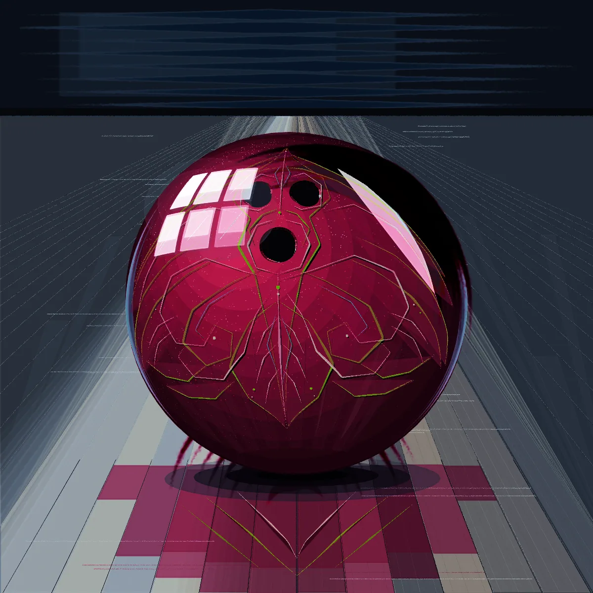
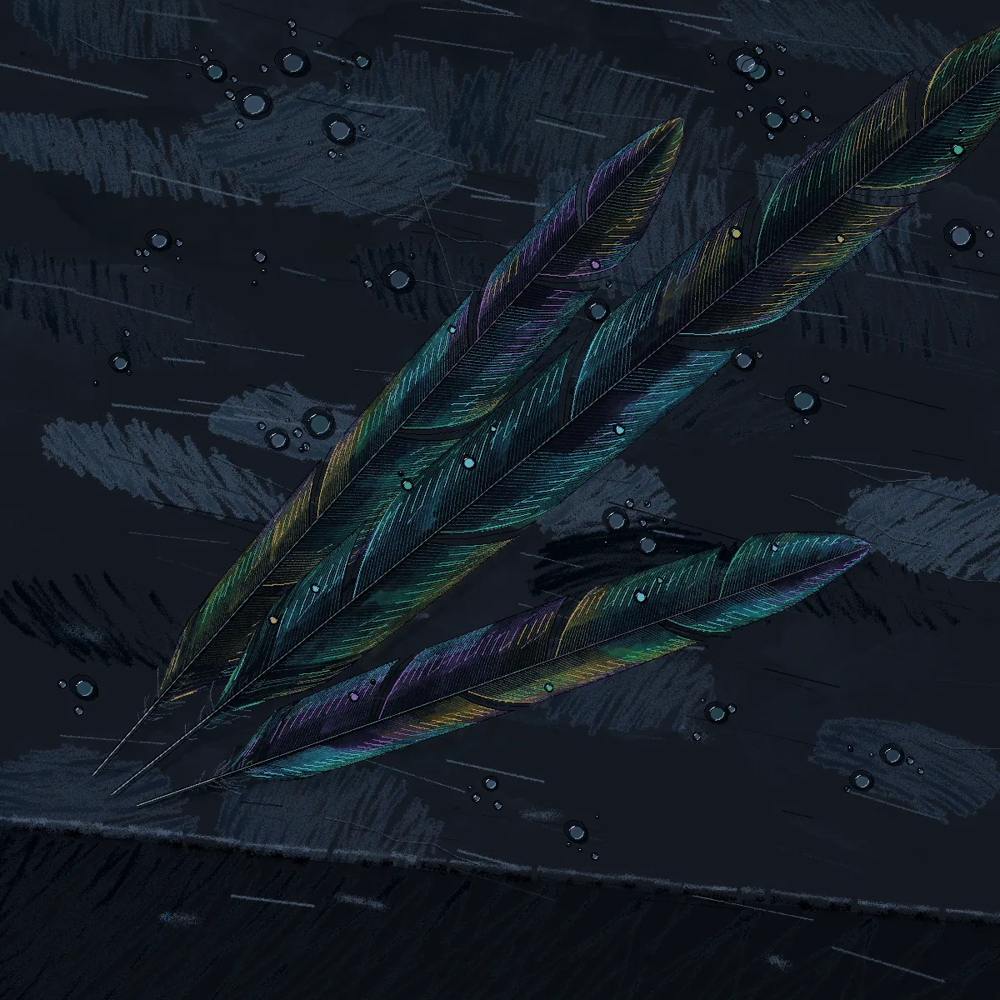
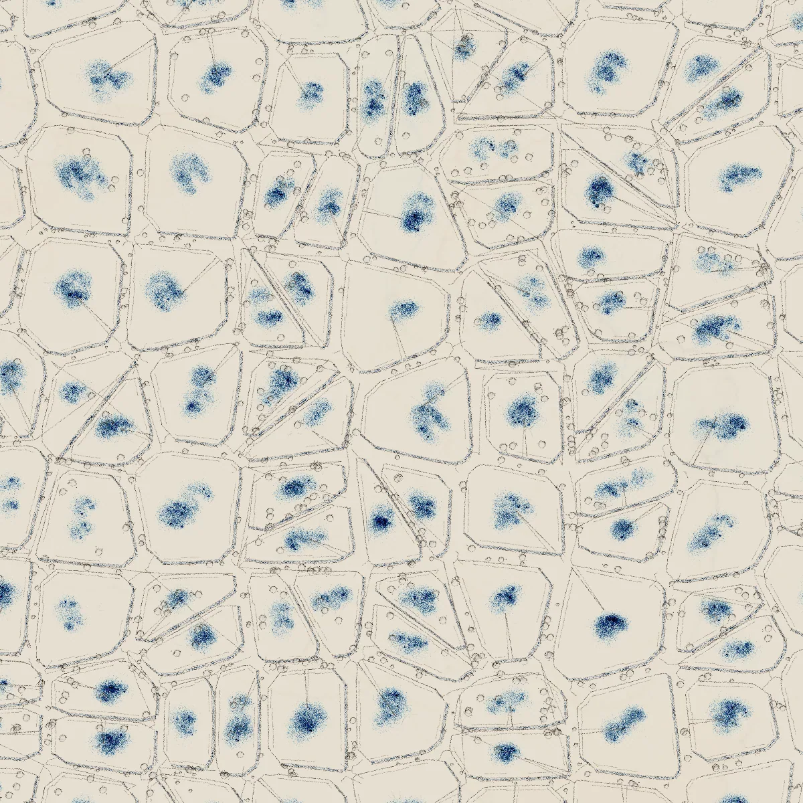
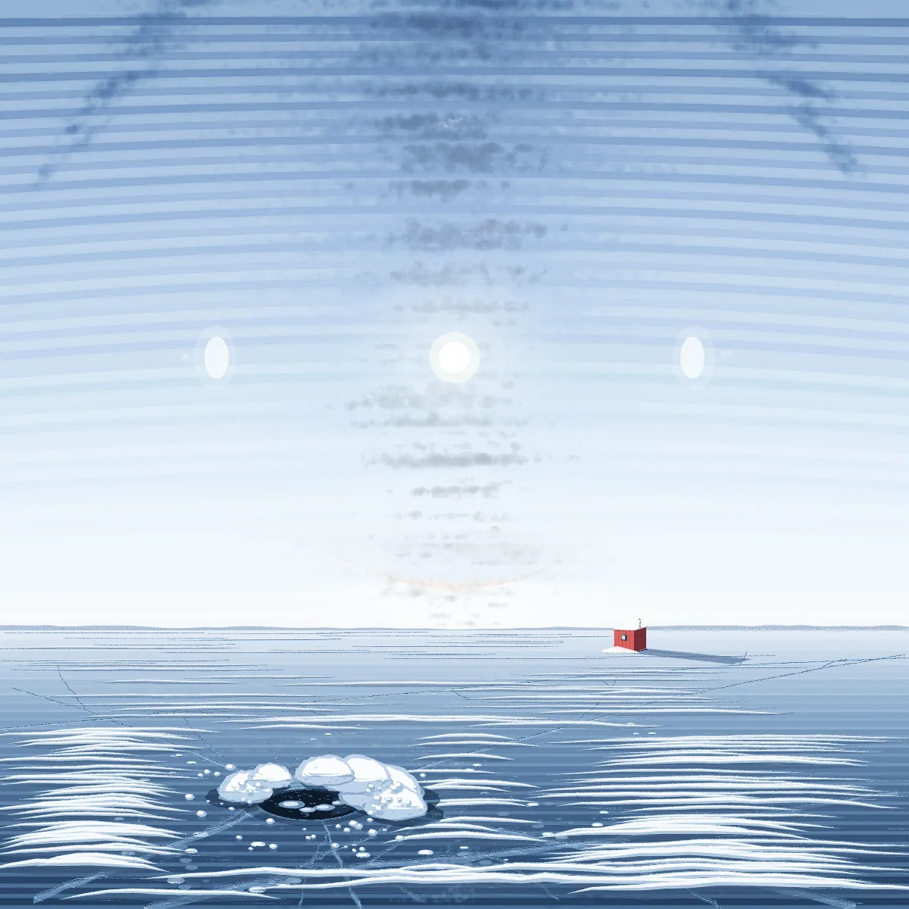
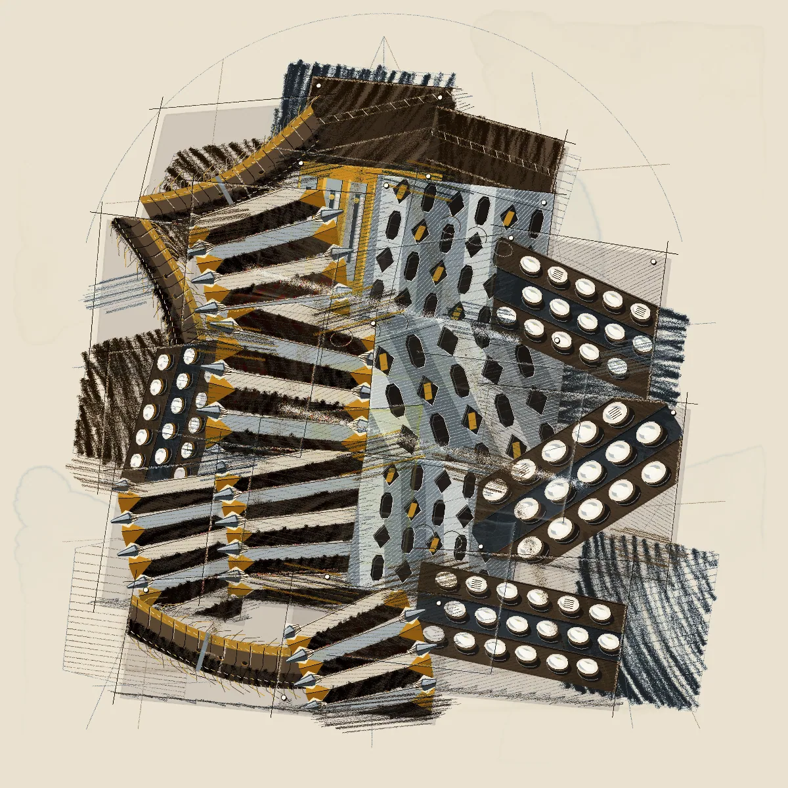
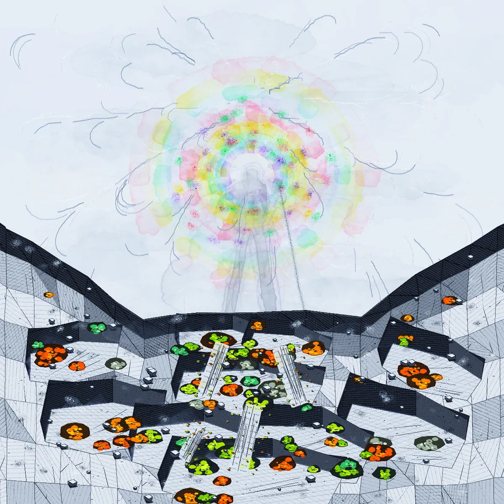

<div align="center">

# 🎨 Argon Paintings

### 534 procedurally painted canvases — every stroke written in code

**Art and code by Surya Narreddi ([@kickingkeys](https://x.com/kickingkeys))** · unofficial preservation mirror

[](#the-paintings) [](#code) [](#wallpaper-use) [](#the-thread-video) [](#rights-and-takedown)

</div>

---

This is a **complete extraction** of the public **"Argon Paintings"** claude.ai artifact
([original artifact](https://claude.ai/artifact/9znB6dfumu3bWHPWiwwNx2)) by **Surya Narreddi
([@kickingkeys](https://x.com/kickingkeys))**, captured on **2026-10-23** (1,966 views on the
artifact at capture time). All credit for every image and every line of painting code belongs
to the author — if you enjoy these, go follow him and boost the original thread.

## 🔥 The thread video

The trending X post that started it all — **[x.com/kickingkeys/status/2110037855452180633](https://x.com/kickingkeys/status/2110037855452180633)**:

> _"Gemini 4 Argon is the first model where It felt like an image, video and language model
> all at once. **Everything in this thread is made with code.** @GoogleAIStudio — More
> examples + the full code for all 534 paintings below ⬇️"_
> — Surya (@kickingkeys)

The video from that post is preserved in this repo:
**[`video/kickingkeys-argon-paintings-thread.mp4`](video/kickingkeys-argon-paintings-thread.mp4)**
(1080×1080, 30.8s, as posted) — also attached to the [releases](../../releases) for in-browser playback.

https://github.com/limitlessprojects/argon-paintings/releases/download/v1.0/kickingkeys-argon-paintings-thread.mp4

## 🖼 Gallery (six of 534)

| | | |
|---|---|---|
|  |  |  |
|  |  |  |

Browse everything via the contact sheets in `contact-sheets/` (9 sheets × 64 thumbnails).

## 📦 What is in here

| Path | Contents |
|---|---|
| `paintings/` | **534 full-res paintings** (1200×1200 webp, ~134 MB) — every one validated after extraction |
| `code/` | **27 code bundles** (`c00.json` … `c26.json`, 20 paintings per bundle) — the actual p5.js v2 + p5.brush (WEBGL) source for each painting |
| `contact-sheets/` | 9 contact sheets (8×8 grid, 64 thumbnails per sheet) |
| `video/` | The thread's original video, as posted by the author |
| `manifest.json` | The gallery's own manifest: `[hash8, slug, bundle, pos, byteOffset, x, y, byteLen]` × 534 + picks / sheet layout / rounds |
| `artifact/` | The original single-file gallery HTML + its loader script, exactly as served |
| `tools/` | The extraction scripts (GitHub Actions fetch job + byte-range reassembler) |
| `make_wallpaper.py` | Turn any painting into a desktop wallpaper (edge-sampled pad) |

## 🧑‍🎨 The paintings

Every painting is painted **by code** — `p5.js` v2 with the `p5.brush` add-on in WEBGL mode:
brush strokes, ink washes, canvas textures, all from loops and vector paths. The bundles
contain the verbatim program for each image (title comment, palette, brush parameters,
composition logic). Slugs name the subject — `pinstripe-candy-bowling-ball`,
`abalone-magpie-feathers-slate`, `adire-indigo-cracked-riverbed`…

## 🖥 Wallpaper use

```bash
python3 make_wallpaper.py paintings/pinstripe-candy-bowling-ball.webp wallpaper.png
# custom resolution: python3 make_wallpaper.py <in.webp> <out.png> 2560 1440
```

Pads the 1200×1200 square onto your desktop resolution using the painting's own edge colours,
so no art is cropped away. Try it on any of the 534.

## 🔍 How this was extracted (transparency)

The artifact's share page is geo-fenced for some regions/hosts, so the capture ran on a
GitHub Actions runner (Azure US egress, real headless browser). Loading the public share page
revealed the artifact frame endpoint on `claudeusercontent.com` — a **public, unauthenticated**
content host — which serves the gallery's manifest, byte-ranged full-res webp bundles and the
code JSONs. `tools/extract_all.py` reassembles each painting from its manifest byte range and
validates the result. No auth bypassed, no private data touched: everything here is what any
visitor to that artifact sees.

## ⚖️ Rights and takedown

The upstream project carries **no open-source license**, so all rights remain with the author
(default copyright), including the video. This mirror exists for access, study and wallpaper
use; if Surya wants it removed or re-licensed, open an issue or reach out — instant takedown.

---

<div align="center">

**Go give [@kickingkeys](https://x.com/kickingkeys) a follow — the originals live on his timeline.**

</div>
